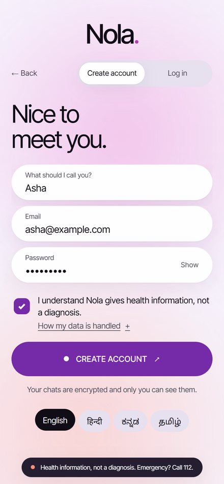
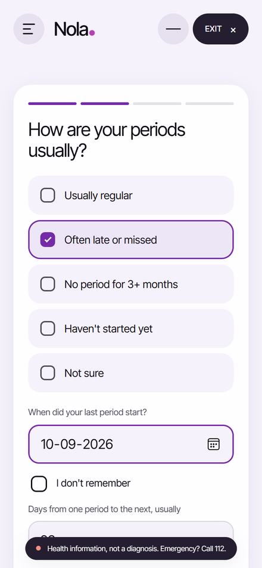
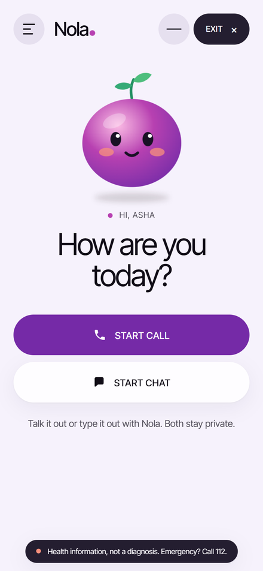
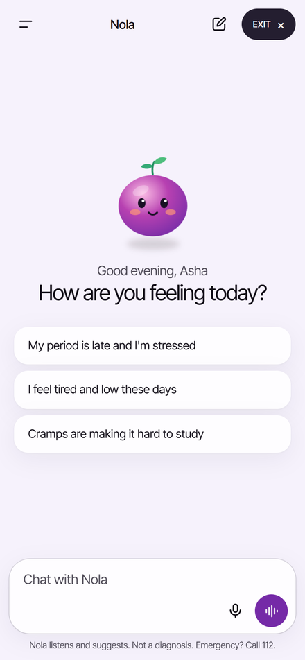
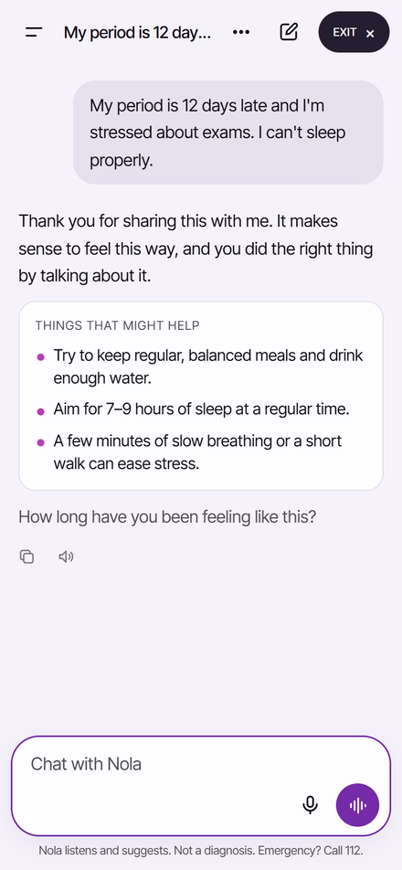
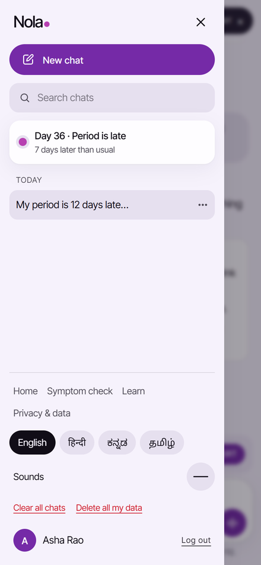
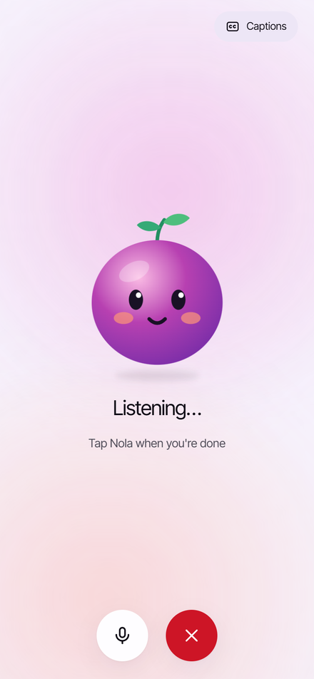
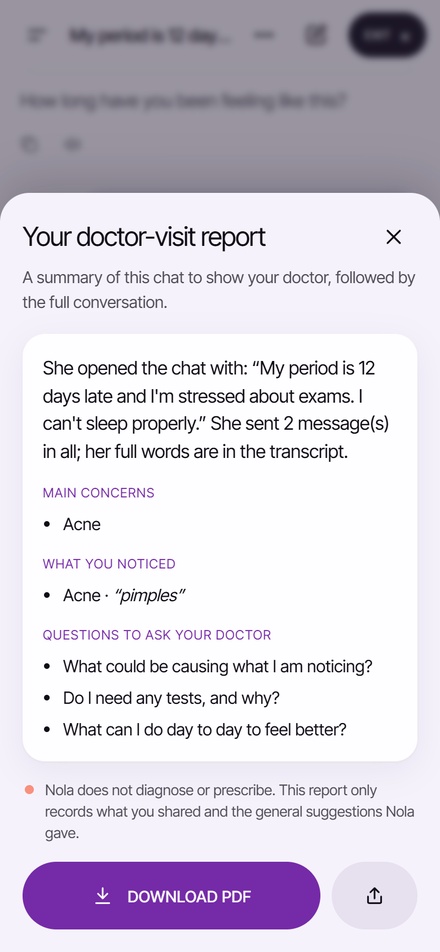
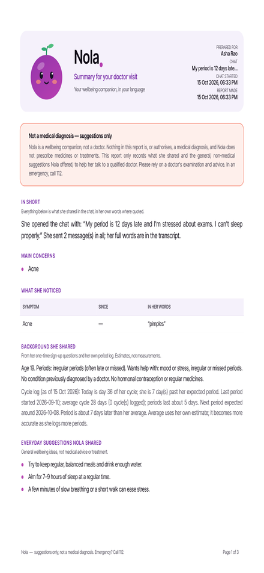
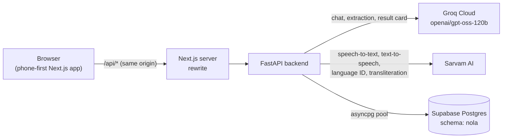

# Nola

**A friend who listens, in your own language.** Nola is a voice- and chat-first companion for menstrual and emotional wellbeing, built for women in India. She can talk or type in English, Hindi, Kannada, Tamil, or a mix like Hinglish, and Nola answers in the same style.

Nola listens, reassures and suggests everyday self-care. **It never diagnoses and never prescribes.** When something sounds serious, it tells her clearly to see a doctor, with emergency numbers one tap away.

<table>
  <tr>
    <td align="center"><br/><sub>Email sign-up</sub></td>
    <td align="center"><br/><sub>One-time questions</sub></td>
    <td align="center"><br/><sub>Home: call or chat</sub></td>
  </tr>
  <tr>
    <td align="center"><br/><sub>New chat</sub></td>
    <td align="center"><br/><sub>Listens, suggests, never diagnoses</sub></td>
    <td align="center"><br/><sub>Saved chats</sub></td>
  </tr>
  <tr>
    <td align="center"><br/><sub>Voice mode</sub></td>
    <td align="center"><br/><sub>Doctor-visit report</sub></td>
    <td align="center"><br/><sub>Report PDF</sub></td>
  </tr>
</table>

> Nola gives health information and care navigation, not medical advice. In an emergency in India, call **112**. For mental-health support, call **Tele-MANAS 14416** (free, 24x7).

## Contents

- [What it does](#what-it-does)
- [How Nola stays safe](#how-nola-stays-safe)
- [Architecture](#architecture)
- [Tech stack](#tech-stack)
- [Getting started](#getting-started)
- [Configuration](#configuration)
- [Project structure](#project-structure)
- [API](#api)
- [Testing and evaluation](#testing-and-evaluation)
- [Languages](#languages)
- [Deployment notes](#deployment-notes)

## What it does

| Feature | What she sees | Where it lives |
| --- | --- | --- |
| **Chat with Nola** (`/chat`) | A phone-app chat: a drawer of saved chats (search, rename, delete, clear all), a warm reply that names how she feels, 0 to 3 self-care suggestions and one gentle follow-up question, copy and read-aloud on every reply | `backend/services/companion.py`, `frontend/components/chat/` |
| **Voice mode** | Full-screen, hands-free conversation: Nola listens, replies out loud and listens again; every turn lands in the same chat | `frontend/components/chat/VoiceMode.tsx` |
| **Doctor-visit report** | After a chat, a branded PDF: what she reported, her own words, when Nola suggested a doctor, the everyday suggestions given, questions to ask, and the full transcript, under a clear "not a diagnosis" notice | `backend/services/report.py`, `backend/services/report_pdf.py` |
| **One-time questions** (`/welcome`) | Right after sign-up, never again: age, how regular her periods are (plus dates), what she wants help with, what a doctor already told her, hormonal medicines. All skippable | `backend/services/profile.py`, `frontend/app/welcome` |
| **Cycle tracking** | Day of cycle, phase, next expected period, how late it is, a "My period started" button; averages improve with each logged period | `backend/services/cycle.py` |
| **Memory** | Nola remembers earlier chats ("last time you mentioned trouble sleeping") through stored history, keyword recall and rolling notes | `backend/services/memory.py` |
| **Symptom check** (`/call`) | Speak in any language; Sarvam transcribes, Nola asks a few follow-up questions, then shows a result card and reads it aloud | `backend/services/orchestrator.py`, `frontend/components/TalkFlow.tsx` |
| **Sounds** | Optional UI sounds (off by default), after the ZEL site; CC0 effects by Kenney | `frontend/lib/sound.ts`, `frontend/public/sfx/` |
| **Doctor card** | A one-page, patient-reported summary (symptom timeline, her own words, cycle notes) with a QR code to show a doctor; never an interpretation | `backend/prompts/doctor_card.md`, `frontend/app/doctor-card` |
| **Learn** | The PCOS to PMOS rename and myth-versus-fact cards, with audio | `backend/kb/myths.json`, `frontend/app/learn` |
| **Quick exit** | One tap clears the session, logs out and jumps to a neutral page, for privacy on shared phones | `frontend/components/QuickExit.tsx` |
| **Delete my data** | "Clear all chats" removes chats and Nola's notes; "Delete all my data" also removes the cycle log and sign-up answers | `DELETE /api/conversations`, `DELETE /api/account/data` |

## How Nola stays safe

Deterministic rules run before and after every model call, and the rules always win.

1. **Red-flag scan first.** Keywords and combinations in `backend/kb/redflags.json` (in English, Hindi, Kannada and Tamil, romanized too) catch heavy bleeding, fainting, severe pain, pain or bleeding in pregnancy, and self-harm. They trigger an emergency or crisis alert with 112 / 108 / Tele-MANAS call buttons, whatever the model says.
2. **The model can raise urgency, never lower it.** The companion returns `see_doctor: no | soon | now` and a distress score from 0 to 3. The app takes the higher of the rules and the model.
3. **Output guardrail.** Every reply is checked against patterns for diagnostic language ("you have PCOS", "diagnosed", including Hinglish forms such as "aapko ... hai"), medicine names, doses, home and herbal remedies, and weight or calorie numbers (`backend/services/guardrail.py`). A failed reply is regenerated once with the reasons; a second failure falls back to a fixed, safe, supportive message.
4. **Prompt rules.** The prompts in `backend/prompts/` forbid diagnosing, naming likely conditions, suggesting self-medication, assuming marital status, or giving diet plans. They also switch off weight and food advice when she mentions an eating concern.
5. **Teen-aware.** Under 18, or fewer than 8 years since her first period, Nola never mentions ultrasound or AMH and suggests involving a trusted adult.

## Architecture



- The browser only talks to `/api` on its own origin. Next.js forwards those calls to FastAPI, so one HTTPS tunnel is enough for microphone access on a phone.
- Only the backend touches the database. The `nola` schema is not exposed through Supabase's Data API and has RLS on every table, so the publishable key cannot read anything.
- Chat text, chat titles, Nola's notes, reports and sign-up answers are encrypted with AES-256-GCM (`backend/services/crypto.py`) before they reach the database. The backend will not start against Postgres without `DATA_ENCRYPTION_KEY`.
- Login is an httpOnly, SameSite cookie holding a random token (only its SHA-256 is stored). Sessions slide forward while in use, and repeated wrong passwords are throttled.
- Every external service has a mock (`MOCK_MODE=true`), so the full flow runs offline without keys. That is how the tests run.

## Tech stack

| Layer | Technology |
| --- | --- |
| Frontend | Next.js 16 (App Router), React 19, TypeScript, Tailwind CSS 4 |
| Backend | Python 3.12, FastAPI, Pydantic 2, httpx, asyncpg |
| LLM | Groq Cloud, `openai/gpt-oss-120b` by default (JSON output validated with Pydantic) |
| Speech and language | Sarvam AI: `saaras:v3` speech-to-text, `bulbul:v3` text-to-speech, text language ID, transliteration |
| Database | Supabase Postgres (local SQLite fallback for tests and offline development) |
| Audio | ffmpeg (optional) for transcoding to MP3 |

## Getting started

### Prerequisites

- Python 3.12+
- Node.js 20+
- Optional: ffmpeg on `PATH` (without it, audio still works as WAV)
- Keys for Groq and Sarvam, and a Supabase project, for real mode. None are needed for mock mode.

### 1. Configure

```bash
cp .env.example .env
```

Fill in the keys you have. With `MOCK_MODE=true` and no keys, everything runs on deterministic mocks.

### 2. Database (Supabase)

Apply the migrations in order, with the Supabase CLI or the bundled script:

```bash
supabase db push
# or, from backend/ with DATABASE_URL set, one file at a time:
python scripts/apply_migration.py ../supabase/migrations/20261015000000_sakhi_schema.sql
python scripts/apply_migration.py ../supabase/migrations/20261016000000_conversations_profiles_reports.sql
python scripts/apply_migration.py ../supabase/migrations/20261016100000_rename_schema_to_nola.sql
```

The project was first called Sakhi, so the first two migrations create a `sakhi` schema and the third renames it to `nola`.

Then set `DATABASE_URL` and `DATA_ENCRYPTION_KEY` in `.env`. Chats saved before encryption existed can be sealed in place with `python scripts/encrypt_existing.py`. If you have data in an old local SQLite file, copy it across (safe to re-run):

```bash
cd backend
python scripts/migrate_sqlite_to_supabase.py --dry-run
python scripts/migrate_sqlite_to_supabase.py
```

Leave `DATABASE_URL` empty to use local SQLite at `backend/data/nola.db` instead.

### 3. Backend

```bash
cd backend
python -m venv .venv
.venv\Scripts\activate          # macOS/Linux: source .venv/bin/activate
pip install -r requirements.txt
uvicorn main:app --reload --port 8000
```

Check it at <http://localhost:8000/api/health>. It reports which services are real or mocked, the database in use, and the model names.

### 4. Frontend

```bash
cd frontend
npm install
npm run dev
```

Open <http://localhost:3000>, sign up with an email, answer the one-time questions (or skip them), and pick **Start chat** or **Start call**.

To try it on a phone, expose port 3000 over HTTPS (for example `cloudflared tunnel --url http://localhost:3000`). Browsers only allow the microphone on HTTPS.

## Configuration

All settings live in the repo-root `.env`; see `.env.example`.

| Variable | Purpose | Default |
| --- | --- | --- |
| `MOCK_MODE` | `true` forces every service to its mock; `false` uses each real service whose key is set | `true` |
| `GROQ_API_KEY` | Groq Cloud key; the LLM is real whenever this is set | empty |
| `GROQ_MODEL` | Groq model id | `openai/gpt-oss-120b` |
| `GROQ_BASE_URL` | Groq OpenAI-compatible endpoint | `https://api.groq.com/openai/v1` |
| `SARVAM_API_KEY` | Sarvam key for speech, language ID and transliteration | empty |
| `SARVAM_STT_MODEL` / `SARVAM_TTS_MODEL` | Sarvam models | `saaras:v3` / `bulbul:v3` |
| `DATABASE_URL` | Supabase Postgres connection string (backend only); empty means local SQLite | empty |
| `DB_POOL_MAX` | Max pooled DB connections per backend process | `10` |
| `DATA_ENCRYPTION_KEY` | AES-256-GCM key (urlsafe base64 of 32 bytes) for chats, notes, reports and sign-up answers. Required with `DATABASE_URL`; back it up, as losing it makes saved chats unreadable | empty |
| `HISTORY_TTL_DAYS` | Chat messages older than this are deleted | `90` |
| `AUTH_TTL_DAYS` | Login session length; renewed while she keeps using the app | `30` |
| `MAX_FOLLOWUPS` | Follow-up questions in the call flow | `4` |
| `SESSION_TTL_MIN` | Call-flow session lifetime (in memory) | `30` |
| `ALLOWED_ORIGINS` | CORS origins for the backend | `http://localhost:3000` |
| `BACKEND_URL` | Where Next.js forwards `/api` | `http://localhost:8000` |
| `FFMPEG_PATH`, `AUDIO_TMP_DIR`, `TTS_OUTPUT_FORMAT`, `TTS_PACE` | Audio handling | see `.env.example` |

`SUPABASE_URL`, `SUPABASE_PUBLISHABLE_KEY` and `SUPABASE_SECRET_KEY` are kept for future Supabase Auth or Storage work; the app does not use them today. Never put a secret in a `NEXT_PUBLIC_` variable.

## Project structure

```text
.
├── backend/
│   ├── main.py                 FastAPI app and routes
│   ├── config.py               settings from .env
│   ├── adapters/
│   │   ├── groq.py             Groq client + LLM adapter (JSON, retries)
│   │   ├── llm.py              LLM protocol + deterministic MockLLM
│   │   └── sarvam.py           speech-to-text, text-to-speech, transliteration
│   ├── services/
│   │   ├── companion.py        sentiment-first companion chat
│   │   ├── cycle.py            cycle maths + cycle store
│   │   ├── memory.py           chats (conversations), recall, rolling notes
│   │   ├── profile.py          one-time sign-up questions
│   │   ├── report.py           doctor-visit report (model summary + guardrail)
│   │   ├── report_pdf.py       branded PDF with Indic text shaping (fpdf2 + HarfBuzz)
│   │   ├── crypto.py           AES-GCM encryption of health data at rest
│   │   ├── language.py         language + script detection (Hinglish)
│   │   ├── orchestrator.py     call flow: extract, follow-ups, result card
│   │   ├── followups.py        which question to ask next
│   │   ├── rules.py            red flags, urgency, teen filters
│   │   ├── guardrail.py        output checks, safe templates
│   │   ├── auth.py             email accounts, login tokens (scrypt), throttling
│   │   ├── db.py               asyncpg pool / SQLite fallback
│   │   └── session.py, audio.py, textnorm.py
│   ├── prompts/                system prompts (companion, notes, report, extract, explain, guardrail, doctor card)
│   ├── assets/                 report fonts (Inter Tight, Noto Sans Indic; OFL) and the Nola mascot
│   ├── kb/                     curated knowledge base, red flags, glossary, myths, care resources
│   ├── eval/                   evaluation cases and scripts
│   ├── scripts/                apply a migration, seal old chats, SQLite to Supabase copy
│   └── tests/                  pytest suite (runs fully offline)
├── frontend/
│   ├── app/                    pages: /, /welcome, /home, /chat, /call, /result, /urgent, /doctor-card, /learn, /about
│   ├── components/chat/        chat app: drawer, messages, composer, voice mode, report and cycle sheets
│   ├── components/             Mascot, SoundToggle, TalkFlow, MicButton, ResultCards, AudioPlayer, ...
│   ├── lib/                    API client, store, i18n, sound, speech
│   └── locales/                UI copy: en, hi, kn, ta
├── supabase/migrations/        Postgres schema
└── docs/screenshots/           images used in this README
```

## API

Routes under `/api/companion`, `/api/conversations`, `/api/profile`, `/api/cycle` and `/api/account` need the `nola_auth` login cookie.

| Method | Path | Purpose |
| --- | --- | --- |
| `GET` | `/api/health` | Service status, mocks, database, models |
| `GET` | `/api/languages` | Supported languages |
| `POST` | `/api/auth/signup` · `/login` · `/logout` | Accounts (sign-up by email; older phone accounts can still log in) |
| `GET` | `/api/auth/me` | Current user, whether onboarding is done; renews the session |
| `GET` / `PUT` | `/api/profile` | One-time sign-up answers (and optional cycle setup) |
| `POST` | `/api/companion/chat` | Send a message (with `conversation_id`, or none to start a chat); returns reply, suggestions, question, alert, cycle, reply language, chat id and title |
| `GET` / `DELETE` | `/api/conversations` | List chats / clear every chat and Nola's notes |
| `GET` / `PATCH` / `DELETE` | `/api/conversations/{id}` | Read a chat's messages / rename / delete |
| `POST` | `/api/conversations/{id}/report` | Doctor-visit report as JSON (cached until the chat changes) |
| `GET` | `/api/conversations/{id}/report.pdf` | The same report as a branded PDF |
| `DELETE` | `/api/account/data` | Delete every chat, notes, cycle log and sign-up answers |
| `GET` / `PUT` | `/api/cycle` | Read status / set up cycle (last start, cycle and period length) |
| `POST` | `/api/cycle/period` | Log a period start |
| `DELETE` | `/api/cycle/period/{date}` | Remove a logged start |
| `POST` | `/api/session` · `DELETE /api/session/{id}` | Call-flow session |
| `POST` | `/api/stt` | Speech to text (multipart audio) |
| `POST` | `/api/analyze` · `/confirm` · `/answer` | Call flow: understand, confirm symptoms, answer follow-ups |
| `POST` | `/api/doctor-card` | Patient-reported summary for a doctor |
| `POST` | `/api/tts` | Text to speech (romanized text is transliterated first) |
| `GET` | `/api/myths` | Myth-versus-fact cards |

## Testing and evaluation

```bash
cd backend
python -m pytest -q             # 78 tests, offline: mocks + SQLite
python eval/run_eval.py         # runs eval/cases.csv through the orchestrator, writes eval/results.md
python eval/validate_rules.py   # checks the PCOS-pattern rules against a labelled dataset, writes eval/dataset_results.md

cd ../frontend
npm run typecheck
```

`validate_rules.py` downloads a public mirror of the Kaggle "Polycystic ovary syndrome (PCOS)" dataset (541 women from Kerala, with a doctor's label) on first run, verifies it by hash and keeps it out of git. It uses only what a woman could report herself.

## Languages

The UI ships in English, Hindi, Kannada and Tamil; other languages fall back to English UI. Replies follow how she writes, not the UI setting:

| She writes | Nola replies in |
| --- | --- |
| English | English |
| Hindi in Devanagari, or Kannada, Tamil, Telugu and other Indian scripts | The same language and script |
| Hindi in English letters (Hinglish) | Hinglish, never plain English or Devanagari |
| A short reply such as "ok thanks" | The language of the conversation so far |

Detection uses the script of the text first, then Sarvam's language identification for Latin text, with a Hinglish word list as a fallback (`backend/services/language.py`). For voice, Hinglish replies are transliterated to Devanagari before text-to-speech, so they sound like Hindi.

## Deployment notes

- **Database host.** Supabase's direct host (`db.<ref>.supabase.co`) resolves over IPv6 on most plans. On IPv4-only platforms, use the Session pooler connection string from Supabase → Connect. The backend disables prepared-statement caching, so the pooler works.
- **Groq free tier.** The free tier allows about 8,000 tokens a minute. The backend waits and retries once on short rate limits, and otherwise falls back to the deterministic extractor or a safe template instead of failing. Upgrade the tier for real traffic.
- **Secrets.** Keep `.env` out of git (it is ignored). Rotate any key that has been shared in chat or email.
- **Backups.** Turn on Point-in-Time Recovery or scheduled backups in Supabase before real users sign up.

## Disclaimer

Nola is a health-information and support tool. It does not diagnose, treat or prescribe, and it is not a substitute for a doctor. The knowledge base (`backend/kb/pcos_kb.md`) is based on the 2023 International Evidence-based Guideline for PCOS and the 2026 PMOS renaming consensus; clinical review is still pending.
